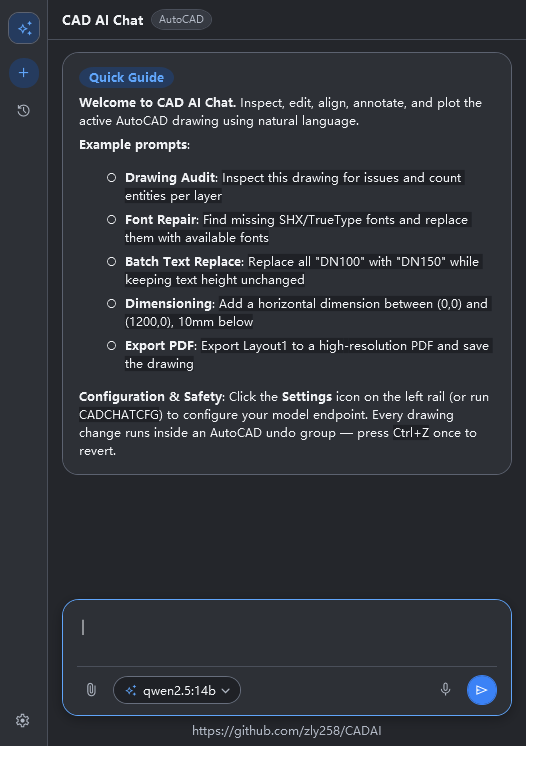
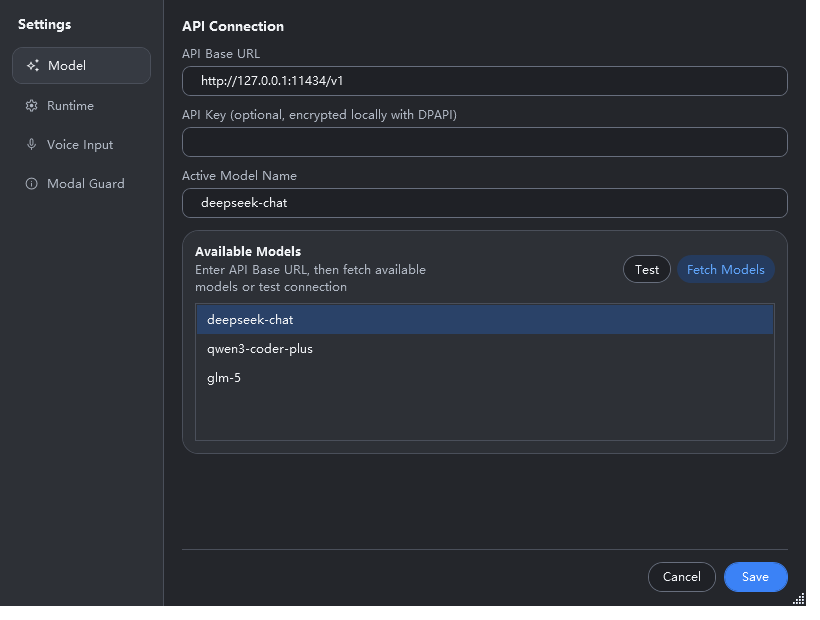

<h1 align="center">CADAI</h1>

<p align="center">Open-source AI chat assistant, modal dialog watchdog, and in-process MCP toolset for Autodesk AutoCAD (2019-2026).</p>

<p align="center">
  <a href="./README.md">English</a> | <a href="./README.zh-CN.md">简体中文</a>
</p>

<p align="center">
  <a href="./LICENSE"></a>   
</p>

CADAI embeds an AI chat workbench directly inside Autodesk AutoCAD. You can inspect drawings, repair missing fonts, batch-edit text, align annotations, draw and dimension geometry, read/write Excel and PDF files, and export layouts to PDF using natural language. Every drawing modification runs inside an AutoCAD document lock and transaction undo group so a single `Ctrl+Z` reverts the entire turn.

## Highlights

| Highlight | Why it matters |
|---|---|
| OpenAI-compatible AI chat core (`CadAI.Core`) | Connects to any OpenAI-compatible API or local Ollama endpoint with streaming output, reasoning-level switching, context compaction, loop-recovery auto-retry, attachments, and voice input. |
| In-process AutoCAD MCP tool engine (`CadAI.Mcp.AutoCAD`) | Executes drawing inspection, font auditing/repair, layer/block/layout management, geometry drawing, dimensioning, text alignment, and PDF/Excel I/O directly inside AutoCAD with scoped tool selection (`CadToolScopePolicy`) and on-demand skills (`skills/dwgai/`). |
| Out-of-process modal dialog watchdog (`CadAI.ModalAgent`) | Automatically dismisses blocking AutoCAD modal dialogs using configurable whitelist rules (`modal-agent.user.json`) and delegates unmatched dialogs over a named pipe to AI safety decisions that block destructive actions. |
| Bilingual UI with one-click Ribbon switch | Full Chinese (`zh-CN`) and English (`en-US`) localization across the Ribbon, Chat, Settings, and About windows via the Ribbon toggle or `CADLANG` command. |
| Multi-version AutoCAD bundle (`CadAI.Host.AutoCAD`) | Dual-targeted for `net48` (AutoCAD 2019-2024) and `net8.0-windows` (AutoCAD 2025-2026), packaged as a standard `CADAI.bundle` with DPAPI-encrypted local API key storage. |

## Interface

### CAD AI Chat



### Settings (Model, Runtime, Voice Input, and Modal Guard)



## Architecture

```text
┌─────────────────────────────────────────────────────────────────────────┐
│                       Autodesk AutoCAD (2019-2026)                      │
│                                                                         │
│  ┌────────────────────────────────┐   ┌──────────────────────────────┐  │
│  │       CadAI.Host.AutoCAD       │   │        CadAI.Core (WPF)      │  │
│  │  Ribbon / Commands / About     │──▶│  AiChatView / AiSettingsWin  │  │
│  │  CADCHAT / CADCHATCFG / CADLANG│   │  AgentSession / StreamClient │  │
│  └───────────────┬────────────────┘   └──────────────┬───────────────┘  │
│                  │                                   │                  │
│                  │ in-process tool dispatch          │ HTTPS / JSON     │
│                  ▼                                   ▼                  │
│  ┌────────────────────────────────┐   ┌──────────────────────────────┐  │
│  │       CadAI.Mcp.AutoCAD        │   │  OpenAI-Compatible / Ollama  │  │
│  │  cad_* Tools + skills/dwgai/   │   │  LLM & Speech API Endpoints  │  │
│  └───────────────┬────────────────┘   └──────────────────────────────┘  │
│                  │                                                      │
└──────────────────┼──────────────────────────────────────────────────────┘
                   │ Named Pipe (AI safety decision bridge)
                   ▼
┌─────────────────────────────────────────────────────────────────────────┐
│                    CadAI.ModalAgent (Out-of-Process)                    │
│  UI Automation modal monitor + whitelist rules + modal-agent.user.json  │
└─────────────────────────────────────────────────────────────────────────┘
```

## Quick Install

### Prerequisites

- Windows 10 / 11 (x64)
- Autodesk AutoCAD 2019-2026
- [.NET SDK 8.0+](https://dotnet.microsoft.com/download) and [PowerShell 7 (`pwsh`)](https://github.com/PowerShell/PowerShell) (when building from source)

### Build and install locally from source

Close AutoCAD before building or deploying so plugin DLLs are not locked:

```pwsh
# Build net48 + net8.0-windows, run all unit tests, and deploy CADAI.bundle
pwsh -ExecutionPolicy Bypass -File .\build.ps1

# Build, test, deploy, and package dist/CADAI.bundle + release zip
pwsh -ExecutionPolicy Bypass -File .\build.ps1 -Publish

# Build and test only (without deploying to AutoCAD)
pwsh -ExecutionPolicy Bypass -File .\build.ps1 -NoDeploy
```

The deploy script installs `CADAI.bundle` to `C:\Program Files\Autodesk\ApplicationPlugins\CADAI.bundle` (or `%APPDATA%\Autodesk\ApplicationPlugins\CADAI.bundle` when running without administrator privileges) and removes duplicate copies.

### Manual bundle installation

Extract the packaged `CADAI.bundle` folder from `dist/CADAI-v1.0.0-AutoCAD2019-2026.zip` into:

```text
C:\Program Files\Autodesk\ApplicationPlugins\CADAI.bundle
```

## Quick Start

1. Launch AutoCAD (2019-2026). The **CADAI** tab appears automatically on the Ribbon.
2. Click **Settings** on the Ribbon (or run `CADCHATCFG`), enter your OpenAI-compatible API Base URL, optional API Key, and click **Fetch Models** to select a model, then click **Save**.
3. Click **CAD AI Chat** on the Ribbon (or run `CADCHAT`) to open the chat window.
4. Type a natural-language instruction for the active drawing, for example:
   - `Inspect this drawing for issues and count entities per layer`
   - `Find missing SHX/TrueType fonts and replace them with available fonts`
   - `Export Layout1 to a high-resolution PDF and save the drawing`
5. Press `Ctrl+Z` in AutoCAD at any time to undo all drawing edits made in the last turn.

## AutoCAD Commands

| Command | Description |
|---|---|
| `CADCHAT` | Open or focus the CAD AI Chat window |
| `CADCHATCFG` | Open Settings (model endpoint, runtime parameters, voice input, modal guard) |
| `CADLANG` | Toggle UI language between English (`en-US`) and Simplified Chinese (`zh-CN`) |
| `CADWORKSPACE` | Open the local conversation workspace directory (`Documents\CADAI`) |
| `CADABOUT` | Open the About window |
| `CADRIBBON` | Manually reload the CADAI Ribbon tab |

## Configuration

- **User settings**: Stored at `%APPDATA%\CADAI\AutoCAD\ai-settings.json`. API keys (`ApiKey`, `VoiceApiKey`) are encrypted at rest with Windows DPAPI (`CurrentUser`).
- **Model configuration**: No default model is pre-selected. Configure your endpoint URL (for example `http://127.0.0.1:11434/v1` for Ollama or any OpenAI-compatible gateway) and fetch or enter a model ID in `CADCHATCFG`.
- **Reasoning loop guard**: Configurable under **Settings -> Runtime** (`AutoRetryOnReasoningLoop`, `MaxRepetitionRecoveryAttempts`).
- **ModalAgent rules**: Configurable under **Settings -> Modal Guard**. Custom whitelist rules are written to `%APPDATA%\CADAI\AutoCAD\modal-agent.user.json` and hot-applied immediately on save.
- **Voice input**: Supports offline Windows local speech recognition (`local`) and OpenAI/Whisper-compatible `/audio/transcriptions` endpoints (`api`).

## Repository Structure

```text
CADAI/
├── src/
│   ├── CadAI.Core          AI chat engine, streaming client, compaction, WPF UI, i18n
│   ├── CadAI.ModalAgent    Out-of-process AutoCAD modal dialog watchdog
│   ├── CadAI.Mcp.AutoCAD   In-process AutoCAD MCP tool engine (cad_* tools)
│   ├── CadAI.Host.AutoCAD  AutoCAD plugin entry, Ribbon, commands, About window
│   └── CadAI.Tests         xUnit test suite
├── skills/
│   └── dwgai/              AutoCAD domain skill pack loaded on demand
├── docs/
│   └── images/             Bilingual GUI screenshots
├── Directory.Build.props   Shared version and AutoCAD SDK reference resolution
├── build.ps1               Build, test, local bundle deploy, and release packaging script
└── CADAI.sln               Visual Studio solution
```

## Community & Support

- GitHub Issues & Pull Requests: [https://github.com/zly258/CADAI/issues](https://github.com/zly258/CADAI/issues)
- Author: [zly258](https://github.com/zly258)
- Sponsor: [Afdian](https://ifdian.net/order/create?user_id=3db8e630e6dc11f1b37452540025c377)

## License

This project is licensed under the [GNU General Public License v3.0 (GPL-3.0-only)](./LICENSE).
