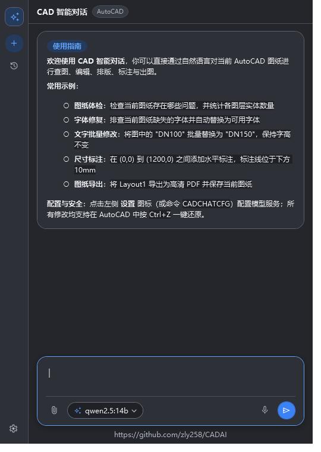
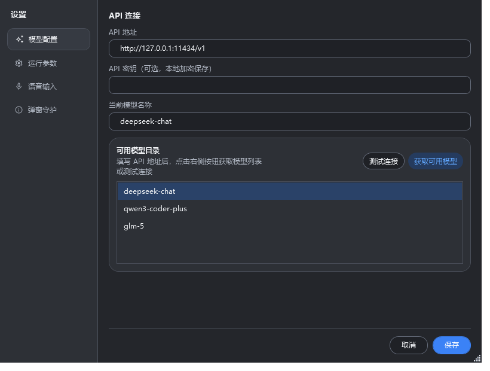

<h1 align="center">CADAI</h1>

<p align="center">面向 Autodesk AutoCAD（2019-2026）的开源 AI 智能对话助手、弹窗看门狗与进程内 MCP 工具套件。</p>

<p align="center">
  <a href="./README.md">English</a> | <a href="./README.zh-CN.md">简体中文</a>
</p>

<p align="center">
  <a href="./LICENSE"></a>   
</p>

CADAI 将 AI 对话工作台直接嵌入 Autodesk AutoCAD 内部。用户可以通过自然语言完成当前 DWG 图纸的查图体检、缺失字体修复、文字批量修改、段落排版对齐、几何绘制与标注、Excel/PDF 读写以及布局导出 PDF。所有改图操作均带文档锁与事务保护，并在同一撤销组内执行，在 AutoCAD 中按一次 `Ctrl+Z` 即可还原整轮修改。

## 核心特性

| 特性 | 说明 |
|---|---|
| OpenAI 兼容对话内核 (`CadAI.Core`) | 支持任意 OpenAI 兼容网关与本地 Ollama 端点，内置流式输出、底部模型与思考等级快速切换、长会话上下文自动压缩、思考死循环自动纠偏重试、附件解析与语音输入。 |
| 进程内 AutoCAD MCP 工具引擎 (`CadAI.Mcp.AutoCAD`) | 内置查图统计、字体排查修复、图层/图块/布局管理、几何绘制编辑、工程标注、文字排版及 Excel/PDF 读写等 `cad_*` 工具，结合工具面收窄策略（`CadToolScopePolicy`）与按需技能包（`skills/dwgai/`）提升调用准确率。 |
| 进程外弹窗守护 (`CadAI.ModalAgent`) | 独立进程监控 AutoCAD 模态阻塞弹窗，优先按可配置白名单规则（`modal-agent.user.json`）自动安全应答；未命中规则时通过命名管道交由 AI 安全决策，并自动拦截危险操作按钮。 |
| 中英文双语界面与 Ribbon 一键切换 | 覆盖 Ribbon 面板、对话窗口、设置窗口与关于窗口的完整中文（`zh-CN`）与英文（`en-US`）切换，点击 Ribbon 语言按钮或输入 `CADLANG` 即可实时生效。 |
| 多版本 AutoCAD 自动加载包 (`CadAI.Host.AutoCAD`) | 双目标框架构建（`net48` 适配 AutoCAD 2019-2024，`net8.0-windows` 适配 AutoCAD 2025-2026），以标准 `CADAI.bundle` 自动加载，本地 API 密钥使用 Windows DPAPI 加密存储。 |

## 界面预览

### CAD 智能对话



### 设置（模型配置、运行参数、语音输入、弹窗守护）



## 架构概览

```text
┌─────────────────────────────────────────────────────────────────────────┐
│                       Autodesk AutoCAD (2019-2026)                      │
│                                                                         │
│  ┌────────────────────────────────┐   ┌──────────────────────────────┐  │
│  │       CadAI.Host.AutoCAD       │   │        CadAI.Core (WPF)      │  │
│  │  Ribbon / Commands / About     │──▶│  AiChatView / AiSettingsWin  │  │
│  │  CADCHAT / CADCHATCFG / CADLANG│   │  AgentSession / StreamClient │  │
│  └───────────────┬────────────────┘   └──────────────┬───────────────┘  │
│                  │                                   │                  │
│                  │ 进程内工具调度                     │ HTTPS / JSON     │
│                  ▼                                   ▼                  │
│  ┌────────────────────────────────┐   ┌──────────────────────────────┐  │
│  │       CadAI.Mcp.AutoCAD        │   │  OpenAI-Compatible / Ollama  │  │
│  │  cad_* Tools + skills/dwgai/   │   │  LLM & Speech API Endpoints  │  │
│  └───────────────┬────────────────┘   └──────────────────────────────┘  │
│                  │                                                      │
└──────────────────┼──────────────────────────────────────────────────────┘
                   │ 命名管道（AI 安全决策桥接）
                   ▼
┌─────────────────────────────────────────────────────────────────────────┐
│                    CadAI.ModalAgent (Out-of-Process)                    │
│  UI Automation 模态弹窗监控 + 自定义白名单规则 + modal-agent.user.json   │
└─────────────────────────────────────────────────────────────────────────┘
```

## 快速安装

### 环境要求

- Windows 10 / 11 (x64)
- Autodesk AutoCAD 2019-2026
- 从源码构建需安装 [.NET SDK 8.0+](https://dotnet.microsoft.com/download) 与 [PowerShell 7 (`pwsh`)](https://github.com/PowerShell/PowerShell)

### 从源码构建并本地安装

构建或部署前请先关闭 AutoCAD，避免 DLL 文件被占用：

```pwsh
# 构建 net48 + net8.0-windows、运行单元测试并部署 CADAI.bundle
pwsh -ExecutionPolicy Bypass -File .\build.ps1

# 构建、测试、部署并打包 dist/CADAI.bundle 与发布压缩包
pwsh -ExecutionPolicy Bypass -File .\build.ps1 -Publish

# 仅编译与测试（不部署到本机 AutoCAD）
pwsh -ExecutionPolicy Bypass -File .\build.ps1 -NoDeploy
```

部署脚本默认将插件安装到 `C:\Program Files\Autodesk\ApplicationPlugins\CADAI.bundle`（非管理员权限下自动回退至 `%APPDATA%\Autodesk\ApplicationPlugins\CADAI.bundle`），并自动清理重复安装包。

### 手动安装发布包

将 `dist/CADAI-v1.0.0-AutoCAD2019-2026.zip` 解压后的 `CADAI.bundle` 目录复制到：

```text
C:\Program Files\Autodesk\ApplicationPlugins\CADAI.bundle
```

## 快速开始

1. 启动 AutoCAD（2019-2026），顶部 Ribbon 自动加载 **CADAI** 页签。
2. 点击 Ribbon 中的 **设置**（或输入命令 `CADCHATCFG`），填写 OpenAI 兼容的 API 地址与可选密钥，点击 **获取可用模型** 点选模型后点击 **保存**。
3. 点击 **CAD 智能对话**（或输入命令 `CADCHAT`）打开对话窗口。
4. 直接用自然语言输入图纸指令，例如：
   - `检查当前图纸存在哪些问题，并统计各图层实体数量`
   - `排查当前图纸缺失的字体并自动替换为可用字体`
   - `将 Layout1 导出为高清 PDF 并保存当前图纸`
5. 对修改结果不满意时，在 AutoCAD 中按一次 `Ctrl+Z` 即可撤回整轮修改。

## AutoCAD 命令

| 命令 | 说明 |
|---|---|
| `CADCHAT` | 打开或切换 CAD 智能对话窗口 |
| `CADCHATCFG` | 打开设置窗口（模型配置、运行参数、语音输入、弹窗守护） |
| `CADLANG` | 在简体中文（`zh-CN`）与英文（`en-US`）界面之间一键切换 |
| `CADWORKSPACE` | 打开本地对话工作区目录（`Documents\CADAI`） |
| `CADABOUT` | 打开关于窗口 |
| `CADRIBBON` | 手动重新挂载 CADAI Ribbon 面板 |

## 配置说明

- **用户配置文件**：保存在 `%APPDATA%\CADAI\AutoCAD\ai-settings.json`，其中的 `ApiKey` 与 `VoiceApiKey` 使用 Windows DPAPI（`CurrentUser`）加密落盘。
- **模型服务配置**：不预设默认模型。请在 `CADCHATCFG` 中显式填写 API 地址（例如本地 Ollama `http://127.0.0.1:11434/v1` 或任意 OpenAI 兼容网关）并获取/选择模型。
- **思考死循环保护**：可在 **设置 -> 运行参数** 中开关自动重试并设置最大纠偏重试次数（`AutoRetryOnReasoningLoop`、`MaxRepetitionRecoveryAttempts`）。
- **弹窗守护规则**：可在 **设置 -> 弹窗守护** 中开关 ModalAgent 与 AI 安全决策，并维护自定义白名单规则；保存后写入 `%APPDATA%\CADAI\AutoCAD\modal-agent.user.json` 并立即热生效。
- **语音输入**：支持 Windows 本地离线语音识别（`local`）与 OpenAI/Whisper 兼容 `/audio/transcriptions` 接口（`api`）。

## 仓库结构

```text
CADAI/
├── src/
│   ├── CadAI.Core          AI 对话内核、流式客户端、上下文压缩、WPF 界面与国际化
│   ├── CadAI.ModalAgent    进程外 AutoCAD 模态弹窗看门狗
│   ├── CadAI.Mcp.AutoCAD   AutoCAD 进程内 MCP 工具引擎（cad_* 工具集）
│   ├── CadAI.Host.AutoCAD  AutoCAD 插件入口、Ribbon、命令与关于窗口
│   └── CadAI.Tests         xUnit 单元测试工程
├── skills/
│   └── dwgai/              AutoCAD 领域技能包（按需加载）
├── docs/
│   └── images/             中英文界面截图
├── Directory.Build.props   统一版本与 AutoCAD SDK 引用解析
├── build.ps1               构建、测试、本地 Bundle 部署与发布打包脚本
└── CADAI.sln               Visual Studio 解决方案
```

## 社区与支持

- GitHub Issues 与 Pull Requests：[https://github.com/zly258/CADAI/issues](https://github.com/zly258/CADAI/issues)
- 作者：[zly258](https://github.com/zly258)
- 赞助支持：[爱发电 (Afdian)](https://ifdian.net/order/create?user_id=3db8e630e6dc11f1b37452540025c377)

## 开源许可

本项目基于 [GNU General Public License v3.0 (GPL-3.0-only)](./LICENSE) 开源。
